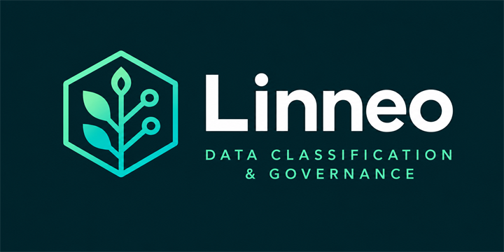

<!--
doc-sources:
  - src/main/java/module-info.java
  - src/main/java/io/github/devbpm/linneo/package-info.java
  - src/main/java/io/github/devbpm/linneo/annotation/package-info.java
  - src/main/java/io/github/devbpm/linneo/classify/package-info.java
  - src/main/java/io/github/devbpm/linneo/processing/package-info.java
  - src/main/java/io/github/devbpm/linneo/catalog/openmetadata/package-info.java
  - src/main/java/io/github/devbpm/linneo/catalog/datahub/package-info.java
  - src/main/java/io/github/devbpm/linneo/catalog/atlas/package-info.java
  - src/main/java/io/github/devbpm/linneo/ens/package-info.java
  - src/main/java/io/github/devbpm/linneo/export/odcs/package-info.java
  - src/main/java/io/github/devbpm/linneo/export/openapi/package-info.java
  - src/main/java/io/github/devbpm/linneo/export/postgresql/package-info.java
  - src/main/java/io/github/devbpm/linneo/extension/university/package-info.java
  - src/main/java/io/github/devbpm/linneo/extension/finance/package-info.java
  - src/main/java/io/github/devbpm/linneo/extension/supplychain/package-info.java
  - src/main/java/io/github/devbpm/linneo/extension/projectoperations/package-info.java
  - src/main/java/io/github/devbpm/linneo/extension/humanresources/package-info.java
-->



# Referencia de Linneo

Linneo es una biblioteca para Java 21 o superior, sin dependencias en tiempo de ejecución, que incluye una taxonomía de
clasificación de datos y la aplica a un modelo de datos. Una `Taxonomy` contiene tres jerarquías de términos con claves
en notación de puntos: **categorías de datos** (qué contiene un campo), **usos de datos** (para qué se tratan) y
**sujetos de datos** (de quién son). La taxonomía estándar es la taxonomía por defecto de fideslang más las extensiones
de Linneo para datos no personales y datos educativos. Cada categoría de datos lleva la protección que requiere
(naturaleza jurídica, confidencialidad, integridad, secreto), que sus hijas heredan y solo pueden endurecer. Los modelos
declaran lo que contienen con anotaciones, un `Classifier` comprueba esas anotaciones en los tests, las actividades de
tratamiento vinculan finalidades, interesados y datos personales con sus bases jurídicas y generan el registro de
actividades de tratamiento del RGPD (y criban cada actividad para saber si necesita una evaluación de impacto), y tres
exportadores traducen la taxonomía para un catálogo de datos: `OpenMetadataCatalog` (clasificaciones y etiquetas de
OpenMetadata), `DataHubCatalog` (un glosario de negocio de DataHub) y `AtlasCatalog` (clasificaciones de Apache Atlas).
Otros tres exportadores publican la clasificación de los campos de un modelo en las herramientas que acompañan al
código: una extensión de OpenAPI, reglas de enmascaramiento para PostgreSQL Anonymizer y el esquema de un contrato de
datos del Open Data Contract Standard. Unos ayudantes opcionales orientan la gravedad de una violación de seguridad de
los datos personales y la categoría de seguridad de un sistema según el ENS español. Las aplicaciones añaden sus
propios términos mediante una `TaxonomyExtension`, y Linneo incluye cinco opcionales (universidades, finanzas, cadena
de suministro, operaciones de proyecto y recursos humanos) que solo se aplican si se piden.

Esta referencia describe todos los tipos públicos. Para una introducción guiada, consulta el
[curso](../course/README.md).

## Módulo y paquetes

El JAR es el módulo JPMS con nombre `io.github.devbpm.linneo`:

```java
module io.github.devbpm.linneo {
    exports io.github.devbpm.linneo;
    exports io.github.devbpm.linneo.annotation;
    exports io.github.devbpm.linneo.classify;
    exports io.github.devbpm.linneo.processing;
    exports io.github.devbpm.linneo.catalog.openmetadata;
    exports io.github.devbpm.linneo.catalog.datahub;
    exports io.github.devbpm.linneo.catalog.atlas;
    exports io.github.devbpm.linneo.ens;
    exports io.github.devbpm.linneo.export.odcs;
    exports io.github.devbpm.linneo.export.openapi;
    exports io.github.devbpm.linneo.export.postgresql;
    exports io.github.devbpm.linneo.extension.university;
    exports io.github.devbpm.linneo.extension.finance;
    exports io.github.devbpm.linneo.extension.supplychain;
    exports io.github.devbpm.linneo.extension.projectoperations;
    exports io.github.devbpm.linneo.extension.humanresources;

    uses io.github.devbpm.linneo.TaxonomyExtension;
}
```

| Paquete | Exportado | Contenido |
|---|---|---|
| `io.github.devbpm.linneo` | sí | La taxonomía (`Taxonomy`, `TaxonomyBuilder`, `TaxonomyExtension`), las diferencias entre dos versiones de ella (`TaxonomyDiff`, `TermChange`), sus términos (`Term`, `TermInfo`, `DataCategory`, `DataUse`, `DataSubject`, `Trait`), los enumerados de protección y `Protection`, y las constantes de claves (`Categories`, `DataUses`, `DataSubjects`) |
| `io.github.devbpm.linneo.annotation` | sí | Las anotaciones que declaran qué contiene cada campo de un modelo: `@Category`, `@DefaultCategory`, `@CategoryByRow`, `@DerivedFrom`, `@Composite`, `@Exempt` |
| `io.github.devbpm.linneo.classify` | sí | Lectura y verificación de las anotaciones de un modelo: `Classifier`, `ClassClassification`, `FieldClassification`, `Violation`, `ClassificationException`, `ModelClasses`; lo que puede salir del sistema de un campo: `DisclosurePolicy`; y la clasificación conservada como datos que una aplicación puede guardar y comparar: `DataInventory`, `InventoryField`, `InventoryDiff`, `FieldChange` |
| `io.github.devbpm.linneo.processing` | sí | Las actividades de tratamiento y el registro de actividades de tratamiento del RGPD: `ProcessingActivity`, `Governance`, `Transfer`, `LegalBasis`, `SpecialCategoryCondition`, `CriminalDataBasis`, `TransferSafeguard`, `ProcessingChecker`, `CheckedActivity`, `ProcessingViolation`, `ProcessingException`, `ProcessingRecord`, `RecordDiff`, `ActivityChange`, `SubjectRights`; el cribado de la necesidad de una evaluación de impacto, `ImpactScreening`; y la gravedad de una violación de seguridad de los datos personales, `BreachAssessment` |
| `io.github.devbpm.linneo.catalog.openmetadata` | sí | La taxonomía como clasificaciones y etiquetas de OpenMetadata: `OpenMetadataCatalog`, `OpenMetadataMapping`, `OmClassification`, `OmTag`. Sin llamadas de red |
| `io.github.devbpm.linneo.catalog.datahub` | sí | La taxonomía como glosario de negocio de DataHub: `DataHubCatalog`, `DataHubMapping`, `DhProposal`. Sin llamadas de red |
| `io.github.devbpm.linneo.catalog.atlas` | sí | La taxonomía como clasificaciones de Apache Atlas: `AtlasCatalog`, `AtlasMapping`, `AtlasClassificationDef`. Sin llamadas de red |
| `io.github.devbpm.linneo.ens` | sí | La categoría de seguridad de un sistema según el ENS español (Real Decreto 311/2022): `EnsCategorization` |
| `io.github.devbpm.linneo.export.openapi` | sí | La clasificación de los datos de una API como la extensión OpenAPI `x-linneo`: `OpenApiExtension` |
| `io.github.devbpm.linneo.export.postgresql` | sí | Reglas de enmascaramiento para PostgreSQL Anonymizer que siguen una política de divulgación: `PostgresAnonymizer`. No se conecta a ninguna base de datos |
| `io.github.devbpm.linneo.export.odcs` | sí | La clasificación de un inventario de datos como el `schema` de un contrato de datos del Open Data Contract Standard: `OdcsSchema` |
| `io.github.devbpm.linneo.extension.university` | sí | Una extensión opcional para universidades, que no se aplica por defecto: `UniversityTaxonomy` y sus constantes de claves `UniversityCategories`, `UniversityDataUses`, `UniversityDataSubjects` |
| `io.github.devbpm.linneo.extension.finance` | sí | Una extensión opcional para finanzas y contabilidad, que no se aplica por defecto: `FinanceTaxonomy` y sus constantes de claves `FinanceCategories`, `FinanceDataUses`, `FinanceDataSubjects` |
| `io.github.devbpm.linneo.extension.supplychain` | sí | Una extensión opcional para la gestión de la cadena de suministro, que no se aplica por defecto: `SupplyChainTaxonomy` y sus constantes de claves `SupplyChainCategories`, `SupplyChainDataUses`, `SupplyChainDataSubjects` |
| `io.github.devbpm.linneo.extension.projectoperations` | sí | Una extensión opcional para las operaciones de proyecto, que no se aplica por defecto: `ProjectOperationsTaxonomy` y sus constantes de claves `ProjectOperationsCategories`, `ProjectOperationsDataUses`, `ProjectOperationsDataSubjects` |
| `io.github.devbpm.linneo.extension.humanresources` | sí | Una extensión opcional para recursos humanos y nómina, que no se aplica por defecto: `HumanResourcesTaxonomy` y sus constantes de claves `HumanResourcesCategories`, `HumanResourcesDataUses`, `HumanResourcesDataSubjects` |
| `io.github.devbpm.linneo.internal` | no | `StandardTaxonomy`, que carga los recursos TSV incluidos, y `Json`, el escritor JSON mínimo que comparten los exportadores. No forma parte de la API pública |

La cláusula `uses` permite que `Taxonomy.load()` y `TaxonomyBuilder.withExtensions()` encuentren extensiones con
`java.util.ServiceLoader`; consulta [Extender la taxonomía](extending.md). El módulo no tiene cláusula `provides`:
las extensiones que incluye se aplican de forma explícita; consulta [Extensiones](extensions/README.md).

Para usar la biblioteca desde una aplicación modular:

```java
module com.example.app {
    requires io.github.devbpm.linneo;
}
```

## Páginas

**Modelo de la taxonomía** (`io.github.devbpm.linneo`)

- [Taxonomía](taxonomy.md) — `Taxonomy` (`standard`, `load`, `builder`, búsquedas, obsolescencia, navegación, forma de
  texto y huella) y `TaxonomyException`.
- [Términos](terms.md) — `Term`, `TermInfo`, `DataCategory`, `DataUse`, `DataSubject`, `Trait`.
- [Niveles de protección](protection-levels.md) — `LegalNature`, `Confidentiality`, `Integrity`, `Identifiability`,
  `Protection` y la regla de herencia.
- [Taxonomía estándar](standard-taxonomy.md) — la taxonomía de fideslang incluida, los añadidos y la política de
  protección de Linneo, los formatos TSV.
- [Constantes de claves](key-constants.md) — `Categories`, `DataUses`, `DataSubjects`.
- [Extender la taxonomía](extending.md) — `TaxonomyBuilder`, `TaxonomyExtension`, `CategoryDraft`, `TermDraft`.
- [Diferencias entre taxonomías](taxonomy-diff.md) — `TaxonomyDiff`, `TermChange`: qué cambió entre dos versiones de una
  taxonomía y las reglas de versionado que lo gradúan.

**Extensiones** (`io.github.devbpm.linneo.extension.university`, `.finance`, `.supplychain`, `.projectoperations`,
`.humanresources`)

- [Visión general de las extensiones](extensions/README.md) — las extensiones opcionales que incluye Linneo, cómo
  aplicarlas o registrarlas y cómo se combinan con las tuyas.
- [Universidad](extensions/university.md) — `UniversityTaxonomy`, `UniversityCategories`, `UniversityDataUses`,
  `UniversityDataSubjects`: todos los términos con su protección, las claves estándar que conviene usar, las reglas
  de derivación y las fuentes.
- [Finanzas](extensions/finance.md) — `FinanceTaxonomy`, `FinanceCategories`, `FinanceDataUses`, `FinanceDataSubjects`.
- [Cadena de suministro](extensions/supply-chain.md) — `SupplyChainTaxonomy`, `SupplyChainCategories`,
  `SupplyChainDataUses`, `SupplyChainDataSubjects`.
- [Operaciones de proyecto](extensions/project-operations.md) — `ProjectOperationsTaxonomy`,
  `ProjectOperationsCategories`, `ProjectOperationsDataUses`, `ProjectOperationsDataSubjects`.
- [Recursos humanos](extensions/human-resources.md) — `HumanResourcesTaxonomy`, `HumanResourcesCategories`,
  `HumanResourcesDataUses`, `HumanResourcesDataSubjects`.

**Anotaciones** (`io.github.devbpm.linneo.annotation`)

- [Visión general de las anotaciones](annotations/README.md) — precedencia y conflictos.
- [`@Category`](annotations/category.md)
- [`@DefaultCategory`](annotations/default-category.md)
- [`@CategoryByRow`](annotations/category-by-row.md)
- [`@DerivedFrom`](annotations/derived-from.md)
- [`@Composite`](annotations/composite.md)
- [`@Exempt`](annotations/exempt.md)

**Clasificación** (`io.github.devbpm.linneo.classify`)

- [Classifier](classify/classifier.md) — `Classifier` (incluido `inventory`), `ClassificationException`,
  `ModelClasses`.
- [Resultados](classify/results.md) — `ClassClassification` (con `Exemption`), `FieldClassification`.
- [Violaciones](classify/violations.md) — `Violation` y cada `Code`.
- [Política de divulgación](classify/disclosure.md) — `DisclosurePolicy` y su `Treatment`: si el valor de un campo se
  muestra, se enmascara o se omite en un log, una exportación o una API; [`PostgresAnonymizer`](export/postgresql.md) la
  convierte en reglas de enmascaramiento de la base de datos.
- [Inventario de datos](classify/inventory.md) — `DataInventory`, `InventoryField`, `InventoryDiff`, `FieldChange`: la
  clasificación como datos, su forma de texto y sus huellas, y la comparación de dos inventarios.

**Actividades de tratamiento** (`io.github.devbpm.linneo.processing`)

- [Visión general de los tratamientos](processing/README.md) — cómo se relacionan las actividades con la taxonomía y
  el clasificador, errores y avisos.
- [ProcessingActivity](processing/activity.md) — `ProcessingActivity`, su `Builder`, `Governance`, `Transfer`.
- [Bases jurídicas](processing/bases.md) — `LegalBasis`, `SpecialCategoryCondition`, `CriminalDataBasis`,
  `TransferSafeguard`.
- [ProcessingChecker](processing/checker.md) — `ProcessingChecker`, `CheckedActivity`, `ProcessingViolation` con
  cada `Code` y `Element`, `ProcessingException`.
- [ProcessingRecord](processing/record.md) — el registro en Markdown y en JSON, su huella, `RecordDiff` y
  `ActivityChange`.
- [SubjectRights](processing/subject-rights.md) — `SubjectRights`: las actividades que tratan los datos de una
  categoría de interesados y los derechos que les da su base jurídica.
- [ImpactScreening](processing/impact-screening.md) — `ImpactScreening`, `Criterion`, `Factor`, `Outcome`: si una
  actividad necesita una evaluación de impacto relativa a la protección de datos, según los criterios de las directrices
  del CEPD y el artículo 35.3.
- [BreachAssessment](processing/breach-assessment.md) — `BreachAssessment`: la gravedad de una violación de seguridad de
  los datos personales según la metodología de ENISA, y lo que el RGPD pide al responsable.

**ENS español** (`io.github.devbpm.linneo.ens`)

- [Categorización del ENS](ens.md) — `EnsCategorization`: la categoría de seguridad de un sistema a partir de la
  clasificación de sus datos y de las dimensiones que declara su responsable.

**OpenMetadata** (`io.github.devbpm.linneo.catalog.openmetadata`)

- [Catálogo](openmetadata/catalog.md) — `OpenMetadataCatalog`, `OmClassification`, `OmTag`, cuerpos JSON,
  correspondencia de etiquetas.
- [Mapeo](openmetadata/mapping.md) — `OpenMetadataMapping`.

**DataHub** (`io.github.devbpm.linneo.catalog.datahub`)

- [Catálogo](datahub/catalog.md) — `DataHubCatalog`, `DhProposal`, nodos y términos del glosario, cuerpos de
  `ingestProposal`, términos de cada campo.
- [Mapeo](datahub/mapping.md) — `DataHubMapping`.

**Apache Atlas** (`io.github.devbpm.linneo.catalog.atlas`)

- [Catálogo](atlas/catalog.md) — `AtlasCatalog`, `AtlasClassificationDef`, tipos de clasificación, cuerpos de
  typedefs y de clasificaciones.
- [Mapeo](atlas/mapping.md) — `AtlasMapping`.

**Exportación** (`io.github.devbpm.linneo.export.openapi`, `.postgresql`, `.odcs`)

- [Visión general de la exportación](export/README.md) — lo que tienen en común los tres exportadores.
- [Extensión OpenAPI](export/openapi.md) — `OpenApiExtension`: la extensión `x-linneo` de cada propiedad de la
  descripción de una API.
- [PostgreSQL Anonymizer](export/postgresql.md) — `PostgresAnonymizer`: las sentencias `SECURITY LABEL` que enmascaran
  o anulan cada columna, según una política de divulgación.
- [Open Data Contract Standard](export/odcs.md) — `OdcsSchema`: el `schema` de un contrato de datos a partir de un
  inventario de datos.

## Comparativa de catálogos de datos

Los tres exportadores publican la misma taxonomía y calculan las etiquetas de cada campo clasificado a partir del
mismo `FieldClassification`; se diferencian en lo que ofrece cada catálogo. Ninguno hace llamadas de red ni aplica
las etiquetas a tus tablas: construyen cuerpos de petición y nombres.

| | OpenMetadata | DataHub | Apache Atlas |
|---|---|---|---|
| Punto de entrada | [`OpenMetadataCatalog`](openmetadata/catalog.md) | [`DataHubCatalog`](datahub/catalog.md) | [`AtlasCatalog`](atlas/catalog.md) |
| Una categoría se convierte en | una etiqueta anidada `DataCategory.<key>` en una clasificación mutuamente excluyente | un término del glosario `urn:li:glossaryTerm:DataCategory.<key>`, más un nodo del glosario si tiene hijas | un tipo de clasificación `DataCategory.<key>` |
| El árbol se convierte en | el `parent` de la etiqueta | nodos que reflejan el árbol, e `isRelatedTerms` hacia el término del padre | `superTypes`: una búsqueda del padre encuentra sus subclasificaciones |
| Protección implícita en una categoría | no se guarda en la etiqueta; va en cada columna con `tagsOf(field)` (`tagsOf(category)` la enumera) | `relatedTerms` de su término | no se guarda en el tipo; `classificationsOf(category)` la enumera |
| Naturaleza jurídica | `PersonalData.Personal` / `SpecialCategory` predefinidas (los datos penales son `SpecialCategory`) | `PersonalData.Personal` / `SpecialCategory` / `CriminalOffence` | `PersonalData.Personal` / `SpecialCategory` / `CriminalOffence` |
| Sensibilidad | `PII.None` / `NonSensitive` / `Sensitive` predefinidas, umbral `sensitiveFrom` | — | — |
| Niveles y secreto | `Confidentiality.*`, `Integrity.*`, `Identifiability.*`, `DataHandling.Secret` | los mismos, como términos del glosario | los mismos, como clasificaciones (no son supertipos de las categorías) |
| Se crea con la taxonomía estándar | 5 clasificaciones y 138 etiquetas | 295 propuestas: 28 nodos, 141 términos y 126 aspectos de relaciones | 147 tipos de clasificación |
| Peticiones | `PUT /api/v1/classifications`, `PUT /api/v1/tags`, una por cuerpo | `POST /aspects?action=ingestProposal`, una por propuesta | un único `POST /api/atlas/v2/types/typedefs` |
| Volver a enviar | crea o actualiza | `UPSERT` (sustituye cada aspecto) | `POST` crea todos o ninguno (409 si uno existe): `createJson` y `updateJson` reparten los tipos para `POST` y `PUT` |
| Etiquetas de un campo | `tagsOf(field)`: nombres de etiqueta | `termsOf(field)`: URN de términos | `classificationsOf(field)`: nombres; `classificationsJson(field)`: cuerpo de la petición |
| Aplicarlas (tu código) | la API de tablas que ya uses | por ejemplo, la mutación GraphQL `addTerms` con la ruta del campo como `subResource` | `POST /api/atlas/v2/entity/guid/{guid}/classifications` |
| Nombres | [`OpenMetadataMapping`](openmetadata/mapping.md): siete nombres y un umbral | [`DataHubMapping`](datahub/mapping.md): seis nombres de nodo | [`AtlasMapping`](atlas/mapping.md): seis nombres de raíz |

Véase también: [curso](../course/README.md) · [English](../../en/reference/README.md)
